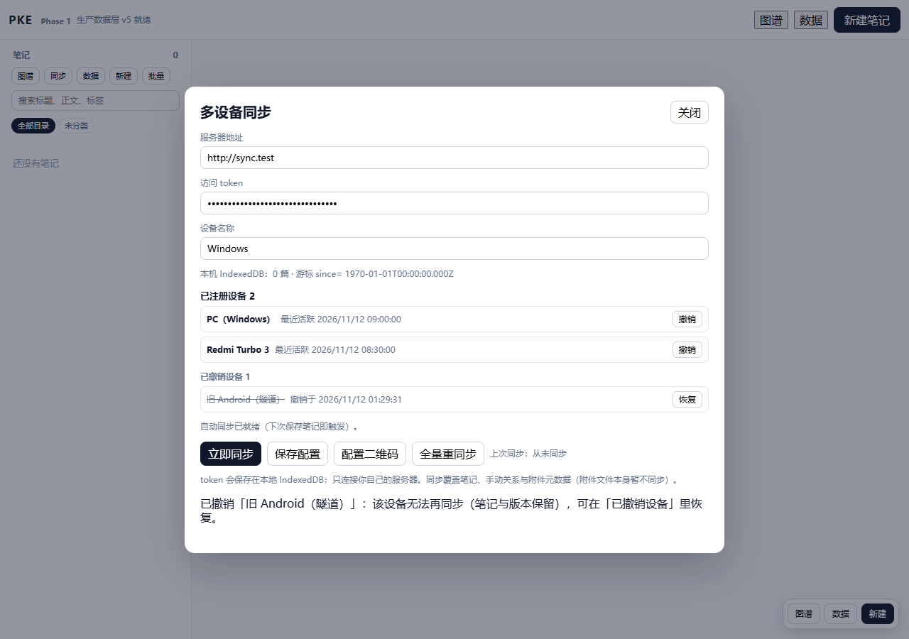

# Phase 4.1 运维增强 — 设备吊销 / 清理旧设备

日期：2026-11-12
工程：`D:\\code\\pke`
状态：**已实现、部署到生产（2026-11-12 01:31）并完成双端验收**；本地与线上回归均通过。

立项背景：Phase 4 收口时设备表只能看不能动，数据里还留着来历不明的旧 Android 记录
（一条来自已废弃的隧道 origin）。本阶段把「看得见」变成「管得住」。

> 命名说明：本文原写作「Phase 5 P5-1」。2026-11-12 项目负责人确认把 **Phase 5 保留给立项设想的 AI**
> （REQ-205 基础 AI 助手 / REQ-301 语义混合检索 / REQ-302 MCP / REQ-304 知识质量分析），
> 设备吊销这一支改称 **Phase 4.1 运维增强**，避免与 AI 阶段重名。

## 一、范围

| 编号 | 内容 | 状态 |
| --- | --- | --- |
| 4.1-a | 设备吊销（移出列表 + 挡住后续 pull/push）与恢复 | 完成 |
| 4.1-b | 同步面板设备列表：每台设备「撤销」、已撤销区「恢复」 | 完成 |
| 4.1-c | 被撤销设备的同步给出可操作提示，而不是「同步服务返回 403」 | 完成 |
| 4.1-d | 服务器回归脚本覆盖吊销全链路，且可重复执行 | 完成 |

不在本阶段：按设备独立 token（见「已知边界」）、自有域名入口、附件自动退避。

## 二、服务端（`server/pke-sync-server.js`）

新增表（启动时 `CREATE TABLE IF NOT EXISTS`，旧库无需手工迁移）：

```sql
CREATE TABLE IF NOT EXISTS revoked_devices (
  id TEXT PRIMARY KEY,
  name TEXT NOT NULL DEFAULT '',
  revoked_at TEXT NOT NULL
);
```

接口：

| 方法 / 路径 | 作用 |
| --- | --- |
| `DELETE /api/v1/devices/:id` | 吊销：写入 `revoked_devices`，从 `devices` 删除该行 |
| `DELETE /api/v1/revoked-devices/:id` | 恢复：从 `revoked_devices` 删除，下次同步重新注册 |
| `GET /api/v1/devices` | 原有 `devices` 之外新增 `revoked: [{id, name, revokedAt}]`（老客户端忽略该字段即可） |

拦截：

- `app.use('/api/v1/pull', rejectRevokedDevice)` 与 `/api/v1/push` 同理，**放在 `touchDevice` 之前**。
  否则被移除的设备下一次同步会把自己写回设备表，吊销就形同虚设。
- 命中吊销 → `403 {ok:false, error:'device-revoked', deviceId}`。

设计取舍：吊销只清设备记录，**不动笔记、版本、冲突基线**；恢复不重建历史记录，
只允许该 deviceId 在下次同步时重新注册。

## 三、客户端

- `src/sync/devices.ts`
  - `fetchDeviceRegistry()` → `{devices, revoked}`；`fetchDevices()` 保留（只返回在线设备）。
  - `revokeDevice()` / `restoreDevice()`：DELETE，返回布尔值（网络失败/拒绝都返回 `false`，不抛异常）。
  - id 用 `encodeURIComponent` 编码；`serverUrl` 末尾斜杠容忍。
- `src/components/SyncPanel.tsx`
  - 设备列表改为逐行渲染（名称 / 最近活跃 / 撤销），本机行禁用撤销并给出原因。
  - 新增「已撤销设备」区，可恢复；操作结果写入面板消息，随后重拉注册表。
- `src/sync/sync.ts`
  - `403 + error='device-revoked'` → 「本设备已被服务器撤销，无法同步；在同步面板「已撤销设备」里恢复本机后可继续。」



## 四、验证

```text
npm run typecheck   -> 通过
npm test            -> 16 files, 66 tests passed
npm run build       -> PWA precache 131 entries / 3278.10 KiB
npx playwright test -> 27 passed（新增 device-revoke.spec.ts）
server verify       -> 37 assertions, ALL PASS
```

- 新增 `tests/unit/devices.test.ts` 用例：注册表解析（含老服务端无 `revoked` 字段）、
  DELETE 路径与 id 编码、拒绝/断网返回 `false`。
- 新增 `tests/unit/sync.test.ts` 用例：403 吊销转成可操作文案。
- 新增 `tests/e2e/device-revoke.spec.ts`：mock 服务端，列表 → 撤销 → 已撤销区 → 恢复，
  并断言实际发出的 DELETE 路径。
- `server/verify-pull-since.js` 增加 11 条断言：吊销后 pull/push 均 403、注册表移除、
  被撤销的 push 不落库、恢复后可同步、未鉴权 DELETE 仍 401；同时把附件目录改为每次临时目录
  （旧版本残留文件会让「上传前 404」假失败，脚本因此不可重复执行）。
- 本地跑服务器回归：`node server/verify-pull-since.js`。`server/package.json` 让 Node 把
  `server/*.js` 当 CommonJS（根 `package.json` 是 `type=module`，否则会报
  `require is not defined`）；依赖可 `cd server && npm install`。

## 五、部署记录（2026-11-12 01:31 +08:00）

服务器 `8.148.85.25`（tailnet `iZn4aglr8axzis0qwqu7mzZ` / `10.0.0.10`）：

| 步骤 | 结果 |
| --- | --- |
| 备份生产库 | `/opt/pke-sync/pke-sync.db.bak-20261112-013058`（better-sqlite3 在线备份，1.9 MB） |
| 备份旧服务端 | `/opt/pke-sync/server.js.bak-20261112-013058` |
| 上传 + 重启 | `server.js`、`verify-pull-since.js` → `systemctl restart pke-sync`（active，`/health` ok） |
| 线上回归 | `node verify-pull-since.js` → **37 assertions ALL PASS**（临时库，不动生产库） |
| 前端 | `dist/` → `/opt/pke-web/site`（旧目录保留为 `site.prev-20261112-013136`），线上 `index-CvEzXzdw.js` |
| 线上冒烟 | 注册 → 吊销 → pull 403 `device-revoked` → 恢复 → pull 200，冒烟设备已彻底清理 |
| 生产注册表 | 部署前后 3 台；按用户确认撤销旧隧道 origin 的 `Android(14500d1d)` 后为 2 台在线 + 1 台已撤销（可恢复） |

验证时的注意点：从非 tailnet 环境（或服务器自身，其 DNS 解析到 Funnel 公网入口）访问
`https://pke.example-tailnet.ts.net/` 会 TLS 失败，这是 `serve` 仅对 tailnet
生效的预期行为；强制解析到 `10.0.0.10` 时返回 200 并渲染新前端。

## 六、已知边界

1. **吊销是 deviceId 维度的卫生措施，不是强认证**：token 是全局共享的，拿到 token 的设备
   换一个 deviceId 仍能同步。要真正吊销，需要「每设备独立 token / 撤销后 token 失效」，
   列为后续项。
2. 被撤销设备本地的数据不会被清除（离线优先设计）；重新注册同一 deviceId 需先「恢复」。
3. 恢复后设备表行由下一次 pull/push 的 `touchDevice` 重建，`createdAt` 会重置为恢复时刻。

## 七、测试基线变化

| 项 | Phase 4 收口 | 本阶段 |
| --- | --- | --- |
| 单元测试 | 16 files / 61 | 16 files / 66 |
| E2E | 26 | 27 |
| server verify | 26 assertions | 37 assertions |
