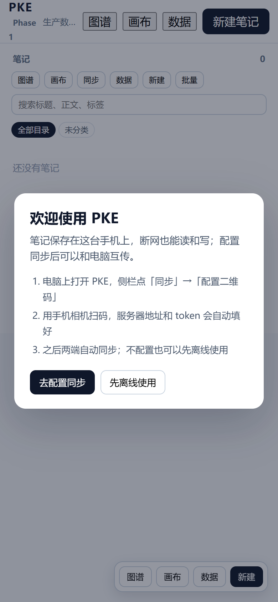

# Phase 4.5 实施记录 — 手机首次配置引导页

日期：2026-11-12
工程：`D:\\code\\pke`
状态：**已实现、通过本地验收并部署**（2026-11-12 02:32；纯前端）。
来源：Phase 4 收口遗留「手机配置引导（首次进入时的引导页）」，按 Phase 4.5 处理。

## 一、范围

| 编号 | 内容 | 状态 |
| --- | --- | --- |
| 4.5-a | 窄屏（≤720px）首次进入、无同步配置时弹引导页 | 完成 |
| 4.5-b | 说明三件事：数据在本机可离线；PC 生成二维码、手机扫码配置；不配置也能用 | 完成 |
| 4.5-c | 「去配置同步」直接打开同步面板；「先离线使用」关闭并记住 | 完成 |
| 4.5-d | 桌面端、已配置、或通过扫码链接进入时不弹 | 完成 |
| 4.5-e | E2E 覆盖显示一次 / 跳过 / 打开面板 / 桌面不显示 | 完成 |



## 二、实现

- `src/components/MobileOnboarding.tsx`：引导卡片（欢迎语 + 三步说明 + 两个动作），
  `data-testid="mobile-onboarding"`、`onboarding-open-sync`、`onboarding-skip`。
- `src/App.tsx`：
  - 启动时判定：`matchMedia('(max-width: 720px)')` 为真、URL hash 不是扫码配置、meta 里没有
    `mobile_onboarding_seen`、且 `loadSyncConfig()` 没有有效 serverUrl/token —— 才显示。
  - 两个动作都会写 `mobile_onboarding_seen=1`；「去配置同步」同时打开 `SyncPanel`。
  - 扫码流程（`#sync=...`）会自己写配置并打开面板，所以不会先弹引导。
- `src/styles.css`：`.onboarding` 卡片与按钮样式（宽度自适应 `min(420px, 100vw - 32px)`）。
- `tests/e2e/mobile-layout.spec.ts`：进入后先关掉引导（它原本就是 390px 视口），再验证单栏布局。

## 三、验收与测试

```text
npm run typecheck   -> 通过
npm test            -> 19 files, 78 tests passed（本轮无单元改动）
npx playwright test -> 34 passed（新增 mobile-onboarding.spec.ts 3 条）
server verify       -> 52 assertions ALL PASS（服务端本轮无改动）
```

新增 E2E：

1. 390×844 首次进入 → 引导可见（含「配置二维码」说明）→「先离线使用」→ 消失；
   刷新后不再出现。
2. 「去配置同步」→ 同步面板打开、引导消失；刷新后不再出现。
3. 默认 1280 视口不显示引导（只对手机窄屏出现）。

## 四、已知边界

1. 「已看过」标记写在当前 origin 的 IndexedDB `meta` 里；清除站点数据或换 origin 会重新出现一次
   （换 origin 本地数据本来就不可见，重新引导合理）。
2. 只判断宽度 ≤720px，不区分触摸/桌面窄窗口；桌面把窗口拖到很窄也会看到引导（可接受）。
3. 引导页只给文字步骤，不内置二维码扫描器；实际配置仍走「扫码打开链接 → 自动写入」路径。

## 五、部署记录（2026-11-12 02:32）

- 仅前端：`dist/` → `/opt/pke-web/site`（旧站点 `site.prev-20261112-023221`），线上
  `assets/index-CCPMJVFH.js`；服务端未重启。
- 手机 PWA 刷新一次后生效。
