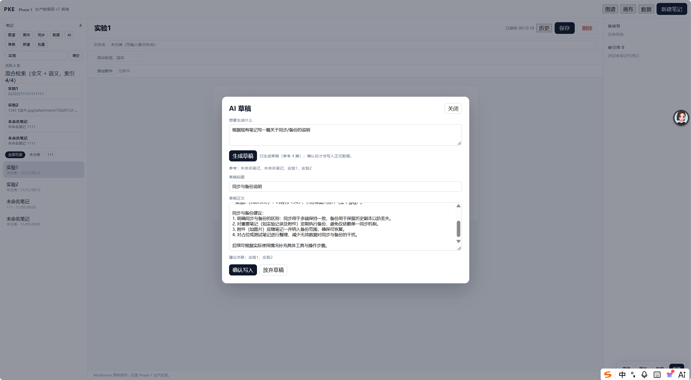

# Phase 5.1 实施记录 — 语义混合检索（REQ-301）

日期：2026-11-12
工程：`D:\\code\\pke`
状态：**已实现、评审修复、通过本地验收并部署**（2026-11-12 18:57）。
上游依据：`docs/phase5-bootstrap.md` 5.1；需求原文：`pke/docs/req-open.json` REQ-301。

## 一、范围

| 编号 | 内容 | 状态 |
| --- | --- | --- |
| 5.1-a | schema v7：`embeddings` 表，只存本机 | 完成 |
| 5.1-b | 切块：去 Markdown、每块 ≤500 字、每篇 ≤20 块 | 完成 |
| 5.1-c | 增量索引：按 `noteUpdatedAt` / 模型判断过期，单次最多 50 篇 | 完成 |
| 5.1-d | 余弦相似度 + RRF（k=60）与 BM25 融合 | 完成 |
| 5.1-e | **回退**：向量关闭 / 索引为空 / provider 失败 → 纯 BM25 | 完成 |
| 5.1-f | 设置面板：语义检索开关、重建索引、已索引统计 | 完成 |
| 5.1-g | 搜索 UI：混合命中 + 「混合检索/全文检索」标识 | 完成 |

## 二、实现

**数据（schema v7）**

- `src/storage/db.ts`：新增 `embeddings` 表（主键 `noteId`，索引 `model`），
  行结构 `NoteEmbedding { noteId, model, dimension, noteUpdatedAt, updatedAt, chunks[] }`。
  `chunks` 每项 `{ text, offset, vector }`。
- `src/storage/embeddings.ts`：按模型查、put/delete/clear、计数。
- **只存本机**：不参与同步（sync 只推 notes/relations/attachments），不进入 ZIP/加密备份。

**检索（`src/search/vector.ts`）**

- `stripMarkdown` / `chunkNote`：去掉图片与链接语法、代码块标记；按句子边界切块，硬上限。
- `cosine`：维度不一致/零向量返回 0。
- `rankByVector`：每题取每个笔记的**最高分块**，过滤 ≤0，按分数排序。
- `mergeHybrid`：RRF `1/(k + rank + 1)`，同篇两路命中标记 `via='both'`，展示优先用全文片段。
- `hybridSearch`：先算 BM25；未开向量 → 直接返回 BM25；向量为空/异常 → 返回 BM25 并给出原因。

**索引（`src/search/vectorIndex.ts`）**

- `ensureVectorIndex`：只处理「没有行 / 模型不同 / noteUpdatedAt 不一致」的笔记；
  每批 8 个分块调用 `embed()`；写入前校验数量、维度；单篇失败计数，连续 3 次失败停止（避免打满网络）。
- `rebuildVectorIndex`：清空后全量重建（设置面板按钮）。
- 默认单次最多 50 篇，大库分批；重建不受 50 限制。

**UI**

- `AiPanel`：新增「启用语义检索」开关、`重建向量索引` 按钮、`已索引 N 篇（模型 …）` 状态与进度。
- `App`：搜索词变化且向量开启时，防抖 250ms → 增量建索引 → `hybridSearch`；
  结果替换列表并显示「混合检索（全文 + 语义）」；失败/关闭则回退 BM25 并隐藏标识。
- 既有 BM25 结果、点击打开、命中高亮行为不变。

## 三、验收与测试

```text
npm run typecheck   -> 通过
npm test            -> 24 files, 114 tests passed
npx playwright test -> 43 passed（新增 hybrid-search.spec.ts 2 条）
server verify       -> 52 assertions ALL PASS（服务端本轮无改动）
```

- 单元（`tests/unit/vector.test.ts`）：切块与 Markdown 清理；余弦/RRF 排序与 `via`；
  增量索引（重复运行 0 篇、内容变更 1 篇、重建全量）；provider 连续失败不抛；v6→v7 迁移保留笔记、索引为空；
  **混合检索命中 BM25 找不到的语义内容**；向量关闭回退；provider 失败回退。
- E2E（`tests/e2e/hybrid-search.spec.ts`）：两篇笔记（「火星…」与「苹果…」），查询「红色星球」——
  BM25 无命中、向量命中火星笔记；关闭向量后同一查询 0 条且不再显示混合检索。

## 四、评审修复（2026-11-12）

独立评审发现 4 个 P1，已全部修复：

| 问题 | 修法 |
| --- | --- |
| AI 总开关不生效：`enabled=false` 仍会建索引/发嵌入 | `hybridSearch` 与 `ensureVectorIndex` 都先检查 `enabled`（fail-closed，0 次嵌入）；App 搜索 effect 同样前置；E2E 新增「AI 关闭 → 0 次 embedding 请求」 |
| 新查询窗口期残留旧混合结果并误报「混合检索」 | 记录 `hybridForQuery`，只有与当前查询一致才采用；每次 effect 入口清空；加 20s AbortController 超时 |
| 重建先清空、失败即丢索引 | 重建改为逐篇覆盖，失败保留旧行；仅全部成功才清理其它模型旧行；提示「失败/剩余/旧索引保留」 |
| 每次搜索同步建索引、并发重复嵌入 | 同模型构建单飞（in-flight 复用）；AbortSignal 贯穿 embed/ensure，查询变化即取消 |

同时处理的关键 P2：索引覆盖率显示（`索引 x/y`）、失败原因显示（401/维度不一致等）、
维度不一致时回退并提示重建、重建前先保存设置、远端重建二次确认、索引状态区分「已索引/待更新/总数」、
RRF 结果上限 20、删除笔记级联清理索引、面板「清空索引」按钮、同分按 noteId 稳定排序、迁移测试补齐其它表。

仍未处理（记录为边界）：索引读取目前会把整表向量载入内存（规模上限见下）、错误不持久化/无熔断、
关闭向量不自动清空索引（提供手动清空）、远端 provider 的嵌入仍受 5.0 授权闸门约束而非逐次确认（留 5.2）。

## 四·补、真实模型验证（2026-11-12 20:15）

主库使用真实云端 provider：**DeepSeek `deepseek-chat`（chat）+ 硅基流动 `BAAI/bge-m3`（embedding）**。

- AI 面板两个端点分别「测试连接」成功；分别授权后重建索引：**4 篇 / 4 个分块，已索引 4/4**。
- 搜索「实验」返回 4 条，并显示「混合检索（全文 + 语义，索引 4/4）」。
- 同一面板可关闭「启用语义检索」回退纯 BM25（行为已由 E2E 覆盖）。



## 五、已知边界

1. **索引只在本机**：换设备/清站点数据后需重建（搜索时自动增量重建，需要模型可用）。
2. 全量余弦扫描，未做 HNSW/近似索引；当前规模（每篇 ≤20 块、单次 ≤50 篇）足够，规模上去再优化。
3. 单次构建上限 50 篇：超大库首次搜索可能需多次触发或点一次「重建向量索引」。
4. 模型切换不自动删除旧模型的索引（按 `model` 过滤），重建按钮会清空。
5. **远端 provider 的嵌入会把分块内容发出去**：已受 5.0 的远端授权闸门约束（授权时明确告知会发送内容）；
   5.2 的逐次发送确认尚未覆盖嵌入调用，届时统一处理。
6. 本地模型仍受 CORS 限制：手机/PWA 从 ts.net 直连 Ollama 需要 `OLLAMA_ORIGINS` 或代理，当前以 PC 端为准。
7. 索引质量取决于模型；没有做阈值调参（当前过滤余弦 ≤0，取最高分块）。
8. 索引读取是「整表载入」：当前量级（几十篇 × ≤20 块）可接受；上千篇时需要分块元数据表或近似索引。
9. 关闭语义检索不会自动删索引（可手动「清空索引」）；关闭后搜索不再读它。

## 六、部署记录（2026-11-12 18:57）

- 纯前端：`/opt/pke-web/site`（旧站点 `site.prev-20261112-185648`），线上 `assets/index-oXdDxFlf.js`。
- 服务端未重启；向量索引默认关闭（`vectorSearchEnabled=false`），需在 AI 设置里打开才会建索引。

## 七、下一步

5.2 REQ-205 AI 草稿助手：检索 top-k → 生成 `{title, body, relations[]}` 草稿 → 用户确认后写入（进版本历史），
发送前用 5.0 的 `describeRemoteSend()` 做逐次确认。
