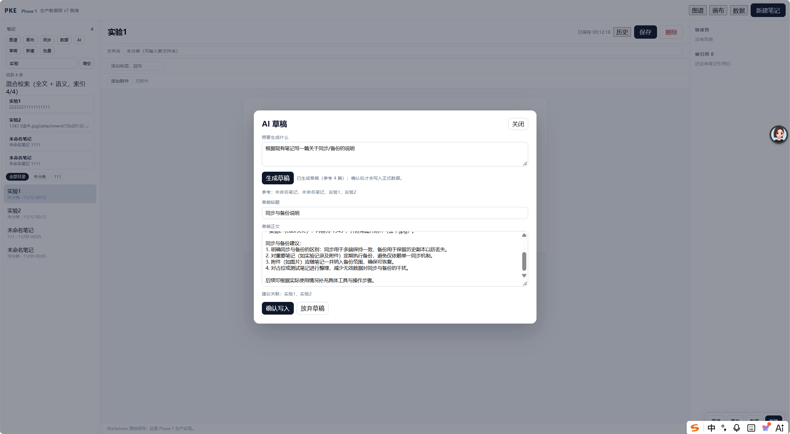
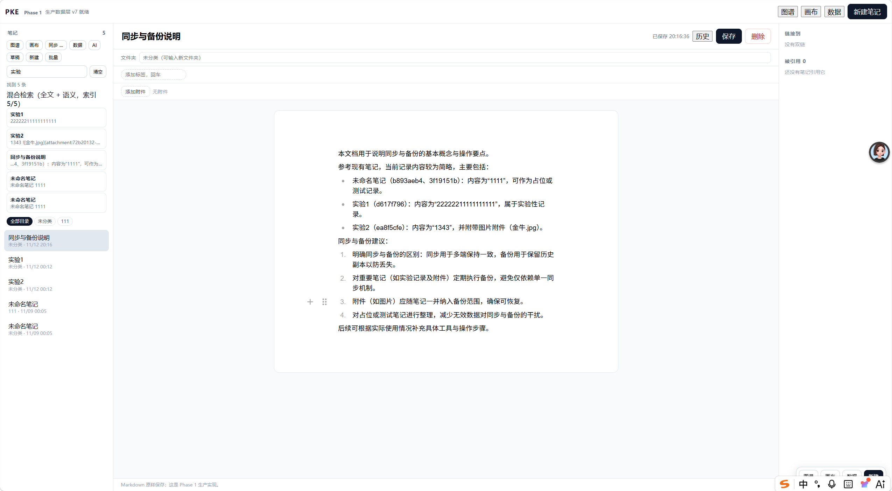

# Phase 5.2 实施记录 — AI 草稿助手（REQ-205）

日期：2026-11-12
工程：`D:\\code\\pke`
状态：**已实现、通过本地验收并部署**（2026-11-12 19:13）。
上游依据：`docs/phase5-bootstrap.md` 5.2；需求原文：`pke/docs/req-open.json` REQ-205。

## 一、范围

| 编号 | 内容 | 状态 |
| --- | --- | --- |
| 5.2-a | 入口：侧栏「草稿」→ 输入意图 | 完成 |
| 5.2-b | 检索参考：向量开启时用 5.1 混合检索，否则 BM25；取前 5 篇 | 完成 |
| 5.2-c | 生成 `{title, body, relations[]}` 草稿并预览，**不写库** | 完成 |
| 5.2-d | 用户确认后创建笔记；关系建议落成手动关系；进版本历史 | 完成 |
| 5.2-e | 远端 provider 发送前逐次确认（`describeRemoteSend`） | 完成 |
| 5.2-f | 30s 超时、错误提示、放弃草稿 | 完成 |

## 二、实现

**`src/ai/draft.ts`**

- `buildDraftPrompt(intent, sources)`：把意图与前 5 篇参考（每篇正文截断 800 字）组成 system/user 消息；
  system 要求**只输出 JSON**，结构固定。
- `parseDraft(raw, allowedIds)`：容忍代码块围栏与前后说明；校验 title/body；
  `relations[].targetNoteId` 必须在本次检索到的 id 集合里，否则丢弃（防模型编造/越权）。
- `generateDraft()`：调用 provider.chat（temperature 0.3），返回校验后的草稿。

**`src/components/AiDraftPanel.tsx`**

- 输入意图 → 检索参考（`hybridSearch` 或 `searchBm25`）→ 生成 → 预览（标题/正文可编辑）→ 确认写入或放弃。
- 确认：`createStoredNote` 创建笔记 → 逐条 `addManualRelation` → `notifyLocalChange()` → 通知 App 刷新并选中。
- AI 未启用时只提示；远端地址在生成前弹 `window.confirm` 并写明目标 origin 与将发送的篇数/字符数。
- 30 秒 AbortController 超时；放弃时明确提示「未写入任何数据」。

**`src/App.tsx`**：侧栏新增「草稿」入口（`data-testid="sidebar-draft"`），面板懒加载，创建后刷新列表并选中新笔记。

## 三、验收与测试

```text
npm run typecheck   -> 通过
npm test            -> 25 files, 118 tests passed
npx playwright test -> 45 passed（新增 ai-draft.spec.ts 2 条）
server verify       -> 52 assertions ALL PASS（服务端本轮无改动）
```

- 单元（`tests/unit/aiDraft.test.ts`）：prompt 含意图与参考 id；围栏 JSON 解析；非法关系 id 被丢弃；
  缺标题/非 JSON 报错；`generateDraft` 走 provider 并校验。
- E2E：生成草稿后**笔记数不变**（仍 1 篇），确认后变 2 篇且编辑区显示草稿标题；
  放弃路径不写入、笔记数保持 0。

## 三·补、真实模型验证（2026-11-12 20:15）

用 DeepSeek `deepseek-chat` 生成、硅基流动 `BAAI/bge-m3` 做检索参考：

- 意图「根据现有笔记写一篇关于同步/备份的说明」→ 参考 4 篇笔记，生成草稿「同步与备份说明」，
  含正文与 2 条关系建议（实验 1、实验 2）；
- 草稿只在预览区出现，**笔记数不变**；
- 点「确认写入」后笔记数 4 → 5，自动选中新笔记，搜索索引变为 5/5；
- 关系建议落成**手动关系**（图谱里可见连线）；右侧链接面板只显示 `[[双链]]`，所以新笔记显示「没有双链 / 被引用 0」是预期。





## 四、已知边界

1. 参考只取前 5 篇、每篇截断 800 字；没有做多轮追问/流式输出。
2. 草稿只生成标题与正文，不生成标签/文件夹；关系建议只针对本次检索到的笔记。
3. 模型返回非 JSON 时直接报错（不猜测修复）；提示用户重试。
4. 远端 provider 的发送确认是「每次生成一次」；嵌入调用（若开启向量）仍只受 5.0 授权约束。
5. 真实模型质量未验证——5.2.5（本地模型环境）完成后补真机验证。

## 五、部署记录（2026-11-12 19:20）

- 纯前端：`/opt/pke-web/site`（旧站点 `site.prev-20261112-191317`），线上 `assets/index-BTS1oLNp.js`；服务端未重启。
- 功能默认关闭：需要先在 AI 设置里启用 AI 与（可选）语义检索。

## 六、下一步

5.2.5 本地模型环境（Ollama + 嵌入/对话模型）→ 用真实 provider 验证 5.1 语义检索与 5.2 草稿 → 再进 5.3 MCP。
